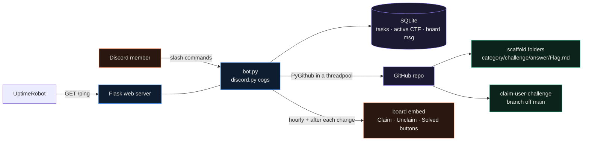

<div align="center">

# CTF Task Tracker Bot

**A Discord bot for running a CTF as a team: slash commands track each challenge on a live board and scaffold a matching folder tree and per-person branch in a GitHub repo.**


</div>

During a CTF my team kept losing track of who was on which challenge and where the writeups lived. This bot keeps both in one place. A challenge added from Discord shows up on a pinned board with Claim and Solved buttons, and the same action creates the challenge's folder (with Flag and writeup templates) and a personal branch in a GitHub repo, so claiming a task in chat and pushing your work line up without anyone copying paths by hand.

## How it works



The bot stores task state in a local SQLite database (`aiosqlite`) and mirrors structure into GitHub through `PyGithub`. Because PyGithub is synchronous, every GitHub call runs in a thread pool so it does not block the Discord event loop. A Flask server exposes `/`, `/health` and `/ping` so a free host like Render can be kept awake by UptimeRobot. The board message id is stored in the database, so the hourly refresh and the post-action refresh edit the same message in place.

## What a challenge creates in GitHub

Adding a CTF and a challenge builds this layout in the configured repository, and claiming it adds a branch named `claim-{username}-{challenge}` off `main`:

```text
dam-2025/                       # <ctf-name>-<year>
  README.md
  pwn/                          # category
    heap-note/                  # challenge
      question/
        README.md               # prompt
      answer/
        Flag.md                 # flag goes here
        writeup.md              # solution notes
        SOLVED                  # empty marker, added when a challenge is solved
```

The repository is made private while a CTF is active and can be flipped public with `/ctf_publish` once nothing is running, which is how writeups get shared after the event.

## Commands

All commands are Discord slash commands. The bot syncs them to `DEFAULT_GUILD` on startup when that is set, otherwise globally.

| Command | What it does |
|---|---|
| `/ctf_add` | Start a new CTF session (sets the active CTF, creates its folder) |
| `/ctf_done` | Mark the current CTF as finished |
| `/ctf_publish` | Make the repository public, allowed only when no CTF is active |
| `/ctf_list` | List the CTF directories in the GitHub repository |
| `/ctf_clear` | Delete the claim branches for a CTF |
| `/ctf_delete` | Delete a CTF and all of its challenges |
| `/challenge_add` | Add one challenge to the active CTF and scaffold its folder |
| `/challenges_add` | Add several challenges at once |
| `/challenge_delete` | Remove a challenge |
| `/show_repo_structure` | Print the repository tree in the current channel |
| `/update_repo_view` | Refresh the repository structure view |
| `/help` | Show the command list |
| `/give_treat` | A small fun response from the bot |
| `/debug` | Full diagnostics and statistics |
| `/debug_status` | Bot status (uptime, guilds, versions) |
| `/debug_log` | Recent log entries |
| `/debug_task` | Details for one task |
| `/debug_refresh_board` | Force the board message to re-render |

The board itself is interactive: an unclaimed challenge shows a Claim button, a claimed one shows Unclaim and Solved, and claiming is what creates the per-person branch.

## Quickstart

```bash
git clone https://github.com/EllE961/CTF-Task-Tracker-bot.git
cd CTF-Task-Tracker-bot/ctf_task_tracker_bot
pip install -r requirements.txt

cp env.example .env     # then fill in the values below
python bot.py
```

`.env` keys the bot reads:

```text
DISCORD_TOKEN           bot token from the Discord developer portal
DEFAULT_GUILD           guild id to sync commands to instantly (optional)
GITHUB_TOKEN            a token with repo scope on GITHUB_REPO
GITHUB_REPO             owner/name of the repo to scaffold into
BOARD_CHANNEL_ID        channel for the live task board
REPO_VIEWER_CHANNEL_ID  channel for the repository structure view
PORT                    port for the Flask keep-alive server (default 8080)
LEAD_ROLE_NAME          role allowed to run session-level commands
LOG_LEVEL               INFO or DEBUG
```

The bot needs the message content and server members intents enabled on its application, and the GitHub token needs write access to the target repository.

## Repository map

```text
ctf_task_tracker_bot/
  bot.py            entry point: intents, cog loading, error handler, hourly board refresh
  cogs/ctf.py       /ctf_* session commands
  cogs/challenge.py /challenge* scaffolding commands
  cogs/repo_viewer.py repository structure views
  cogs/debug.py     /debug* diagnostics
  github_utils.py   PyGithub: scaffold folders, claim branches, public/private toggle (threadpool)
  db.py             aiosqlite schema and queries: tasks, active_ctf, board_msg, db_stats
  views.py          board embed and the Claim/Unclaim/Solved buttons
  web_server.py     Flask /, /health, /ping for uptime pings
  logging_config.py logging setup
  env.example       configuration template
```

## Limitations

- State lives in a local SQLite file and the bot resets it to a fresh state on every startup (`db.reset_db()`), so it is built to run one CTF at a time on one always-on instance, not as a multi-tenant service.
- Secrets come only from environment variables; there is no committed token, and the database is created at runtime rather than shipped.
- GitHub scaffolding assumes a repo whose default branch is `main`, and that the configured token can set the repository private or public.
- The keep-alive server is there for free hosts that sleep idle processes; on a normal always-on host it is just an unused health endpoint.

## License

MIT. See [LICENSE](LICENSE).
